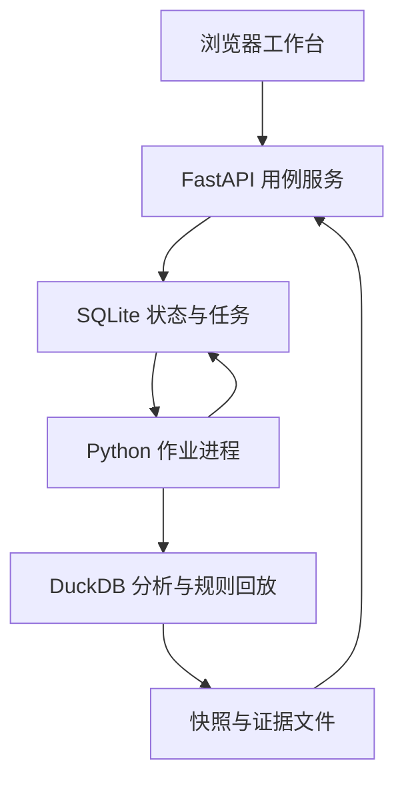

# CampaignLab 应用架构

## 运行形态

Ubuntu x86-64 本机 CPU。一个应用发布包启动一个 Uvicorn HTTP 进程和一个 Python 作业进程。Vite 构建后的静态文件随 HTTP 应用由同一源提供。运行时读取本机数据目录。开发时 Vite 代理 `/api` 到本机服务端，开发地址仅向回环开放。

| 模块 | 读写责任 | 调用边界 |
|---|---|---|
| workspaces | 工作区、会话、权限、审计 | 服务端从会话确定操作者，每次读取校验工作区 |
| activities | 活动、规则版本、条款与绑定 | 使用领域服务保存状态，提供规则对象与版本引用 |
| ingestion | 导入、映射、校验、发布和更正快照 | 通过数据访问接口发出不可变快照与来源证据 |
| analytics | 范围、口径、比较、异常、分解、问答 | 消费已发布快照与定义，输出可重复计算结果 |
| simulation | 场景、规则验证、回放、差分、预发 | 同输入与版本重复运行产生同一业务投影 |
| delivery | 报告、签认、改进、观察、证据包 | 消费结果引用，通过受控状态转换形成记录 |
| jobs | 后台队列、租约、取消、重试和制品发布 | 执行注册任务。每个处理器有明确输入和结果引用 |

HTTP 层负责鉴权、请求解析、错误和响应。用例层负责事务及流程前置条件。领域层负责状态与规则。基础设施层实现 SQLite、DuckDB 和文件访问。模块间通过对象引用和服务接口协作，数据库外键和测试共同守住边界。运行进程共用代码及契约版本。

## 权威数据

| 内容 | 落点 | 来源与变更 |
|---|---|---|
| 活动、规则、案例、审批式确认、任务、报告索引 | SQLite | 事务写入，带版本号。确认后的规则和签认报告形成不可变版本 |
| 原始文件、标准快照、运行结果、导出 | 受控本地目录 | 原文件和标准输出附 SHA-256。发布后内容按标识访问 |
| 分析执行 | 每个作业的 DuckDB 会话 | 读取给定 Parquet，不以共享可写 DuckDB 文件协调进程 |
| 界面视图 | 内存状态和 URL 查询 | 服务器返回的任务与业务状态是权威依据 |

## 数据和任务之间的交接

导入先校验。发布在临时目录生成所有 Parquet、元数据和摘要，文件写完后原子移动至制品路径，再在 SQLite 事务提交可见状态。计算作业固定快照、口径、输入、阈值和规则，输出同样通过制品登记发布。进程中断后重试读取原输入，旧尝试的临时内容在确认无引用后回收。操作序列、租约和恢复见 [任务契约](JOBS.md)。

## 设计决策

面向可复算和个人维护选择 Python 模块化单体。基线由单个应用和执行进程支撑。在出现行内多用户、接口调度或更高吞吐需求时，先验证授权、样本规模和实际维护代价，再另行裁定部署演进。
